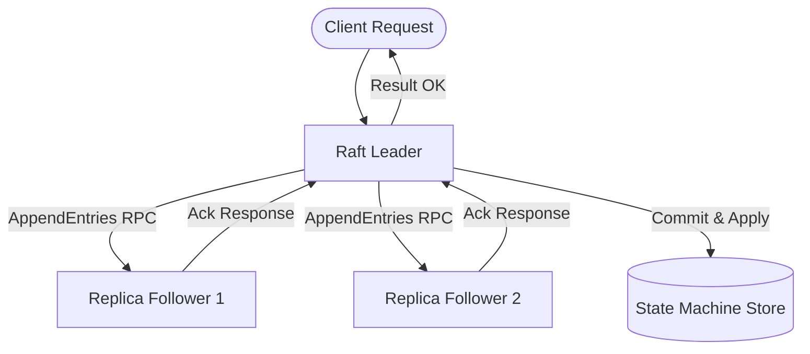
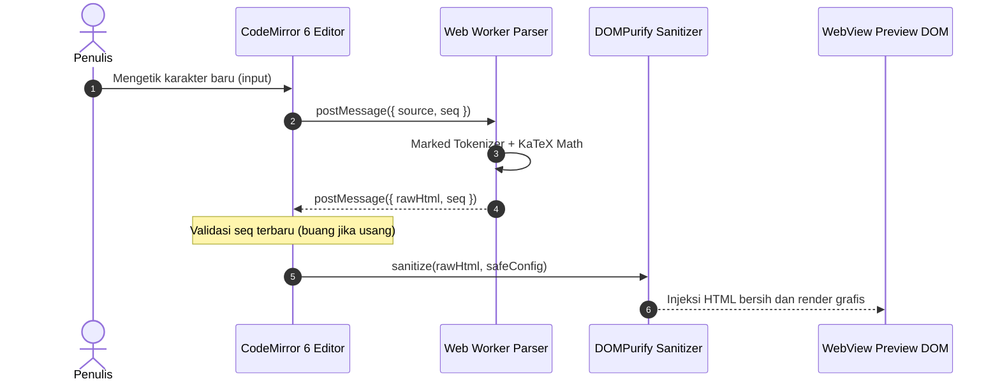

# Bab 1: Sistem Terdistribusi dan Konsensus Berbasis Raft

Dalam arsitektur sistem komputasi terdistribusi modern, konsistensi data di antara beberapa replika independen merupakan tantangan fundamental. Algoritma Raft dirancang agar lebih mudah dipahami dibandingkan Paxos tradisional tanpa mengorbankan keamanan maupun efisiensi operasional. Setiap simpul (node) dalam kluster dapat berada pada salah satu dari tiga status utama: leader, follower, atau candidate. Pemilihan leader diinisiasi ketika follower mengalami timeout tanpa menerima sinyal heartbeat RPC dari leader aktif.

### Formulasi Matematis dan Model Dinamis

Probabilitas terjadinya split vote dapat diminimalkan dengan menetapkan randomized election timeout $T_{election} \in [150\text{ ms}, 300\text{ ms}]$, di mana interval heartbeat konstan adalah $T_{heartbeat} = 50\text{ ms}$.

$$\mathcal{P}_{consensus} = \prod_{i=1}^{\lfloor N/2 \rfloor + 1} p_i(t) \cdot \exp\left(-\frac{\Delta t}{\tau}\right)$$

### Implementasi Referensi Perangkat Lunak

Berikut merupakan implementasi inti algoritma dalam bahasa pemrograman:

```rust
pub struct RaftNode<S: StateMachine> {
    pub id: NodeId,
    pub term: u64,
    pub voted_for: Option<NodeId>,
    pub log: Vec<LogEntry>,
    pub commit_index: usize,
    pub last_applied: usize,
    pub state_machine: S,
}

impl<S: StateMachine> RaftNode<S> {
    pub fn handle_append_entries(&mut self, req: AppendEntriesRequest) -> AppendEntriesResponse {
        if req.term < self.term {
            return AppendEntriesResponse { term: self.term, success: false };
        }
        self.term = req.term;
        self.reset_election_timer();
        AppendEntriesResponse { term: self.term, success: true }
    }
}
```

### Topologi Alur Kerja dan Diagram Eksekusi

Visualisasi grafis interaksi alur sistem:



### Analisis Kinerja dan Implikasi Keandalan

Proses replikasi log memastikan bahwa semua perubahan status diterapkan dalam urutan yang identik pada seluruh mesin replika. Ketika client mengirimkan instruksi mutasi data ke leader, leader menambahkan entri perintah tersebut ke dalam log lokalnya terlebih dahulu sebelum menyebarkannya melalui AppendEntries RPC ke seluruh simpul follower. Setelah mayoritas simpul memberikan konfirmasi penerimaan entri ke disk non-volatile, leader secara resmi menandai entri log tersebut sebagai committed dan menerapkannya pada state machine internal.

> [!NOTE] Keamanan Partisi Jaringan
> Jika partisi jaringan membagi kluster menjadi segmen minoritas dan mayoritas, segmen minoritas tidak dapat mencapai kuorum sehingga mutasi tidak akan pernah di-commit.

### Evaluasi Parameter Kritis

| Parameter Protokol | Batas Minimal | Rekomendasi Produksi | Keterangan |
| :--- | :--- | :--- | :--- |
| Heartbeat Timeout | 20 ms | 50 ms | Interval sinyal periodik leader |
| Election Timeout Min | 100 ms | 150 ms | Batas awal random jitter follower |
| Election Timeout Max | 200 ms | 300 ms | Batas akhir random jitter follower |
| Quorum Size (N=5) | 3 nodes | 3 nodes | Mayoritas mutlak $\lfloor N/2 \rfloor + 1$ |
| Snapshot Chunk Size | 64 KB | 1024 KB | Kompresi transfer state snapshot |

### Lembar Checklist Verifikasi

- [x] Verifikasi checksum blok memori sebelum parsing
- [x] Evaluasi ambang batas latensi rendering per siklus
- [ ] Eksekusi pembaruan cache parsial untuk blok tak berubah
- [ ] Sinkronisasi posisi scroll baris ke blok visual

---

# Bab 2: Optimasi Parsing Dokumen Markdown dan Pipeline Render Virtual DOM

Pemrosesan teks berformat Markdown berskala besar (di atas lima puluh ribu kata) memerlukan strategi parsing berbasis aliran (streaming) atau delegasi thread asinkron untuk mempertahankan frame rate 60 FPS pada antarmuka pengguna. Eksekusi parser monolitik pada thread utama UI dapat menyebabkan frame drops dan latensi input keyboard yang signifikan saat pengguna mengetik dengan cepat.

### Formulasi Matematis dan Model Dinamis

Latensi persepsi pengguna terhadap ketukan keyboard harus dijaga di bawah ambang batas $\tau_{input} < 16.67\text{ ms}$ agar tidak melewati satu siklus refresh tampilan monitor $60\text{ Hz}$.

$$T_{total} = T_{lex}(N_{tokens}) + T_{ast}(N_{nodes}) + T_{katex}(N_{math}) + T_{purify}(S_{html}) + T_{paint}(D)$$

### Implementasi Referensi Perangkat Lunak

Berikut merupakan implementasi inti algoritma dalam bahasa pemrograman:

```typescript
export interface RenderPipelineOptions {
  streaming: boolean;
  maxChunkSize: number;
  enableKaTeX: boolean;
  workerPoolSize: number;
}

export class MarkdownRenderCoordinator {
  private workerSequence = 0;
  private activeRequest: number | null = null;

  constructor(private readonly options: RenderPipelineOptions) {}

  public async dispatchRender(source: string): Promise<string> {
    const seq = ++this.workerSequence;
    this.activeRequest = seq;
    const rawHtml = await this.renderInWorker(source, seq);
    if (this.activeRequest !== seq) {
      throw new Error("Stale render discarded");
    }
    return rawHtml;
  }

  private async renderInWorker(src: string, seq: number): Promise<string> {
    return Promise.resolve(`<div data-seq="${seq}">${src.length} bytes</div>`);
  }
}
```

### Topologi Alur Kerja dan Diagram Eksekusi

Visualisasi grafis interaksi alur sistem:



### Analisis Kinerja dan Implikasi Keandalan

Pemisahan antara tahap pemindaian leksikal (lexing) dan sanitasi keamanan HTML adalah prinsip esensial dalam arsitektur CAMark. Ekstensi parser bertanggung jawab mengubah sintaksis Markdown, blok matematika KaTeX, tabel, dan diagram Mermaid menjadi representasi HTML murni. Namun demikian, keluaran parser mentah tersebut tidak boleh langsung diinjeksikan ke dalam struktur Document Object Model tanpa melalui filter pembersih berbasis daftar putih (allowlist) yang ketat guna mencegah serangan injeksi skrip lintas situs (Cross-Site Scripting).

> [!WARNING] Sanitasi Thread Utama
> Sesuai ketetapan arsitektur CAMark (P-02), pembersihan DOMPurify harus senantiasa dijalankan pada thread utama tempat DOM berada guna memastikan ketersediaan parser HTML native browser.

### Evaluasi Parameter Kritis

| Komponen Pipeline | Lingkungan Eksekusi | Alokasi Waktu Rata-rata | Dampak Terhadap UI |
| :--- | :--- | :--- | :--- |
| Lexing & AST | Web Worker | 15 - 45 ms | Nol (Off-thread) |
| KaTeX Engine | Web Worker | 10 - 30 ms | Nol (Off-thread) |
| DOMPurify | Main Thread | 2 - 8 ms | Rendah (< 1 frame) |
| Layout & Paint | GPU Compositor | 4 - 12 ms | Sinkron layar |
| Mermaid SVG | Asinkron Task | 20 - 80 ms | Non-blocking placeholder |

### Lembar Checklist Verifikasi

- [x] Verifikasi checksum blok memori sebelum parsing
- [x] Evaluasi ambang batas latensi rendering per siklus
- [ ] Eksekusi pembaruan cache parsial untuk blok tak berubah
- [ ] Sinkronisasi posisi scroll baris ke blok visual

---

